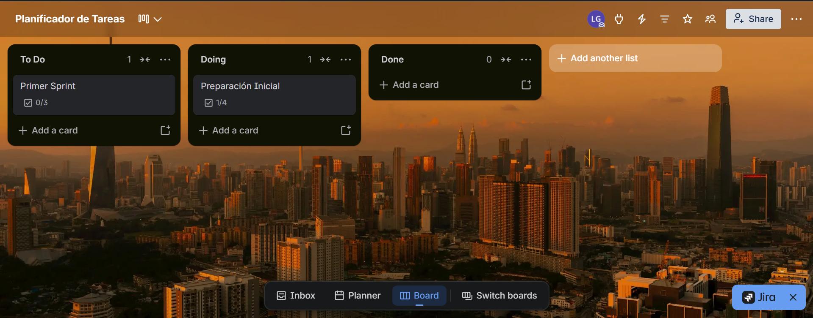

# 📋 Planificador de Tareas Web

Aplicación web personal diseñada para organizar actividades, administrar pendientes y llevar un mejor control de las tareas del día a día. El proyecto busca facilitar la planificación personal mediante una interfaz intuitiva y funcional.

## 🎯 Objetivo

Desarrollar una aplicación web que permita gestionar tareas de manera sencilla, ayudando a mejorar la organización personal, la productividad y el seguimiento de las actividades pendientes.

## ✨ Funcionalidades

- ➕ Crear nuevas tareas.
- 📝 Editar la información de las tareas.
- ✅ Marcar tareas como completadas.
- 🗑️ Eliminar tareas.
- 📋 Visualizar y organizar las actividades pendientes.
- 📱 Consultar la aplicación desde diferentes dispositivos mediante un diseño adaptable.

## 🛠️ Tecnologías utilizadas

- **HTML5:** estructura de la aplicación.
- **CSS3:** estilos y diseño visual.
- **JavaScript:** lógica e interactividad.
- **Git y GitHub:** control de versiones y gestión del repositorio.
- **GitHub Pages:** publicación de la aplicación web.
- **Bootstrap:** Framework de diseño responsivo.

**🚀 Demo en vivo:**

